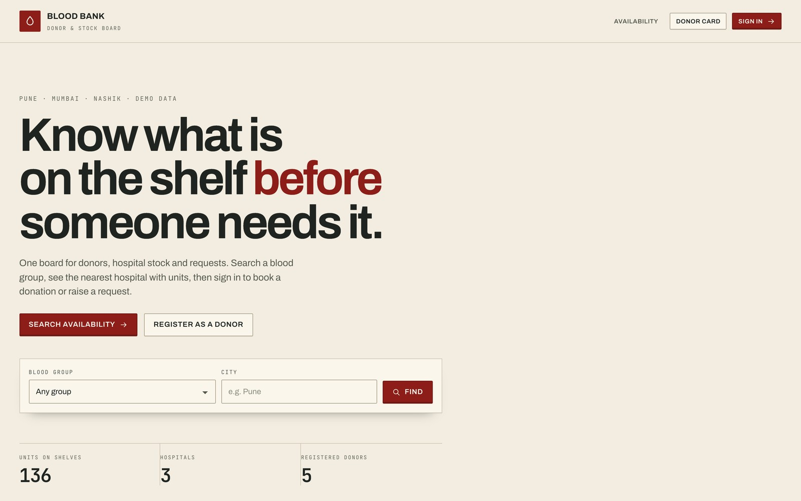
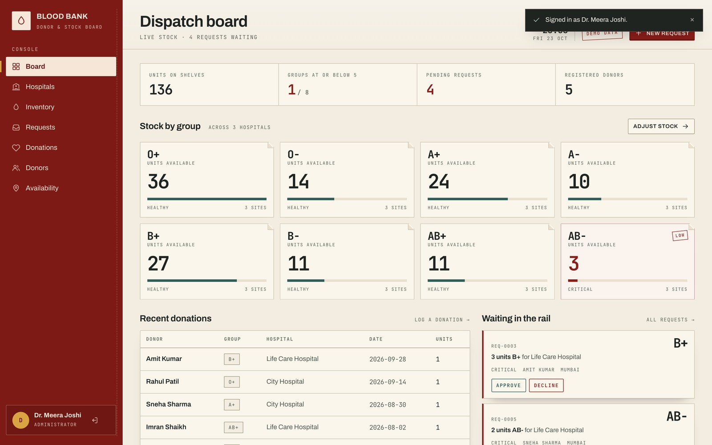
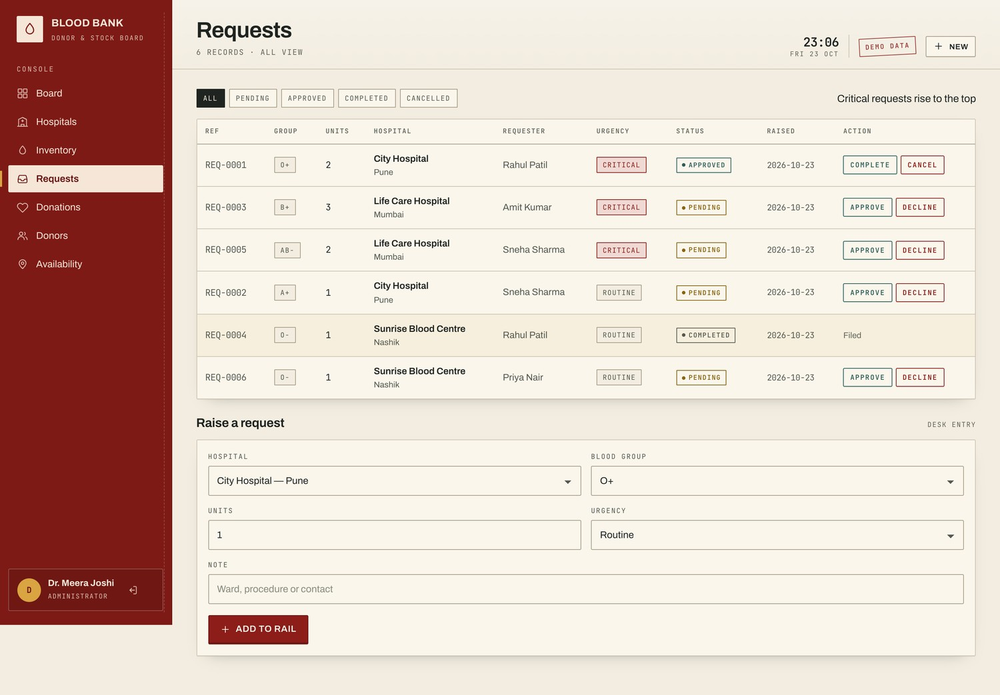
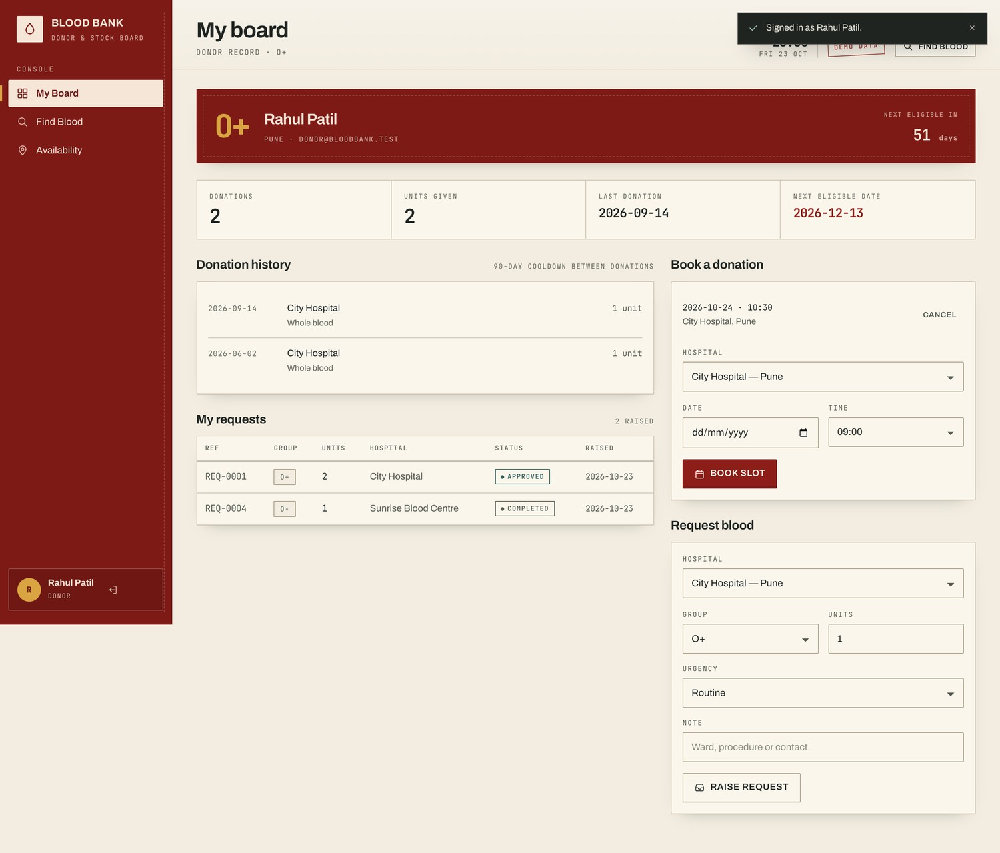
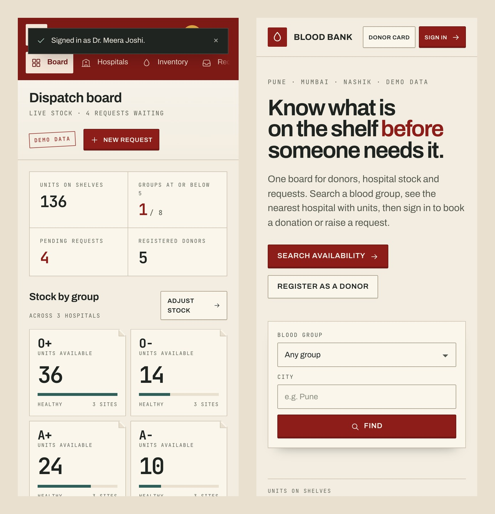

# Online Blood Bank & Donor Management System

A Flask + SQLite academic PBL project for managing blood donors, hospital stock, requests, donations and appointments. The interface is built around a hospital dispatch desk: cream paper, an oxidized-red rail, split-flap stock counters, paper request slips and a rubber-stamp approval flow.

> Academic prototype with synthetic data. Not a clinical system and not intended for medical decision-making.



## Features

- Public blood availability search by blood group and city.
- Donor registration and sign-in with hashed passwords and server-side sessions.
- Donor dashboard with 90-day eligibility, donation history, appointment booking and request history.
- Administrator dispatch board with stock levels, critical groups, pending requests and recent activity.
- Hospital, inventory, donor, donation and request management.
- Request lifecycle enforced by the server: `Pending → Approved → Completed`, with cancellation before fulfilment.
- Stock is deducted only when a valid approved request is completed.
- CSRF protection on every POST, role guards, parameterized SQL and server-side validation.
- Responsive layout with a mobile navigation rail, accessible contrast and reduced-motion support.

## Tech Stack

- Python 3.10+
- Flask 3.1.3
- SQLite
- Jinja2 templates
- Custom CSS and vanilla JavaScript
- Local Archivo and JetBrains Mono fonts

## Quick Start

```bash
git clone https://github.com/adithya-in/blood-bank-management-system.git
cd blood-bank-management-system
python3 -m venv .venv
source .venv/bin/activate
pip install -r requirements.txt
python app.py
```

Open <http://127.0.0.1:5000>.

The SQLite database is created and seeded automatically on first run at `instance/bloodbank.db`.

## Demo Accounts

| Role | Email | Password |
|---|---|---|
| Administrator | `admin@bloodbank.test` | `Admin@123` |
| Donor | `donor@bloodbank.test` | `Donor@123` |
| Donor (secondary) | `sneha@bloodbank.test` | `Donor@123` |

All accounts, hospitals, stock counts and requests are synthetic.

## Screenshots

### Administrator Dispatch Board



### Request Queue and Status Actions



### Donor Dashboard



### Mobile Layout



## Project Report

The PBL implementation report is included in two formats:

- [Report PDF](report/Blood_Bank_Donor_Management_Report.pdf)
- [Editable report DOCX](report/Blood_Bank_Donor_Management_Report.docx)

The DOCX contains cover-page placeholders for student and institution details. Replace them before submission.

## Project Structure

```text
blood-bank-app/
├── app.py                  # Flask application, schema, seed data and routes
├── requirements.txt
├── DESIGN.md               # Visual system and motion notes
├── templates/              # Jinja2 pages
├── static/                 # CSS, JavaScript, fonts and favicon
├── docs/screenshots/       # README screenshots
└── report/                 # PBL report and supporting figures
```

## Resetting the Demo

Stop the server, delete `instance/bloodbank.db`, and start the application again:

```bash
rm instance/bloodbank.db
python app.py
```

The database is recreated and reseeded with the demonstration data.

## Security and Scope

This project demonstrates relational schema design, role-based access, CSRF protection, parameterized queries and server-side state transitions. It does not verify clinical compatibility, screen donated blood, confirm donor identity or replace hospital procedures.
